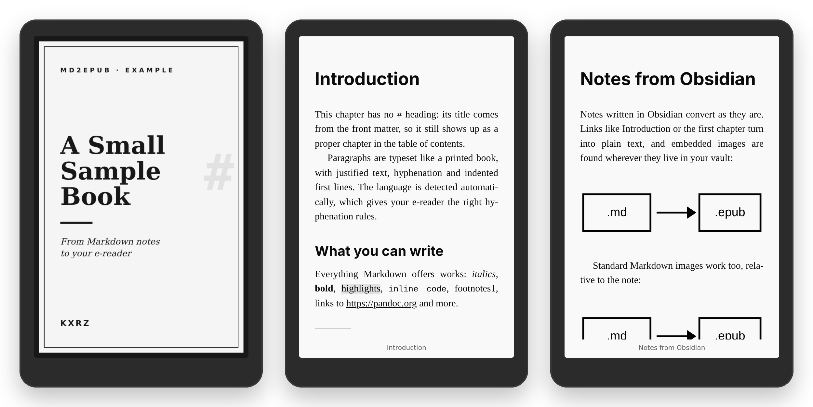
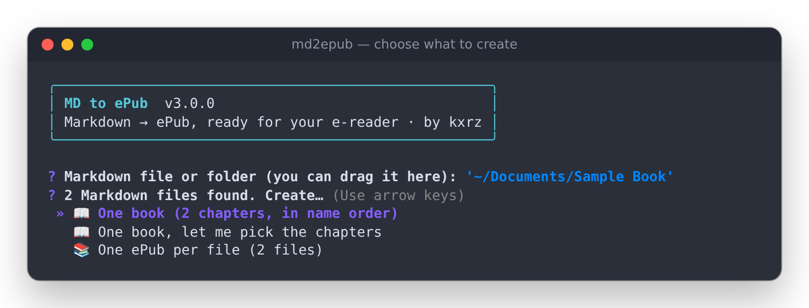
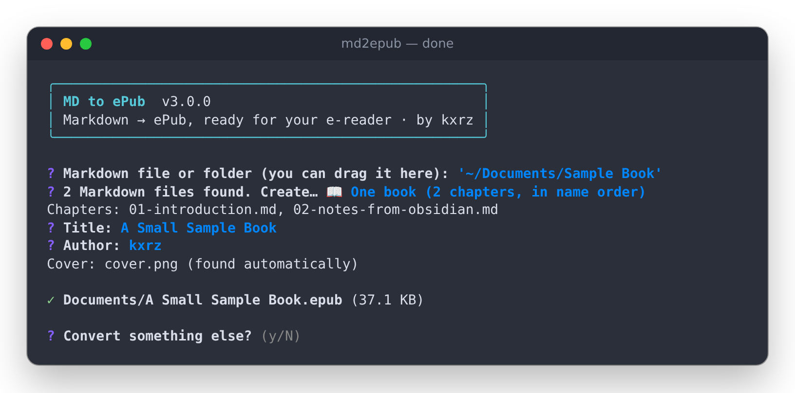
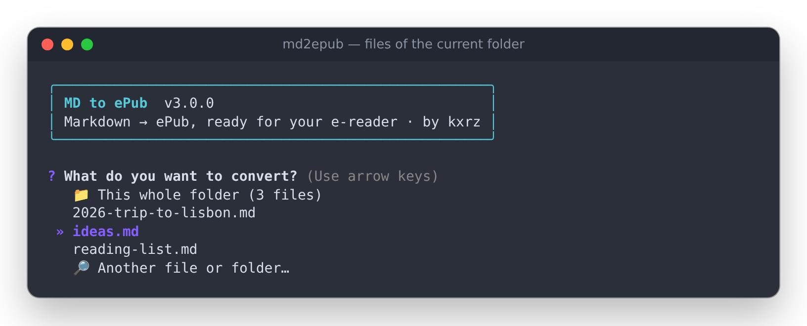
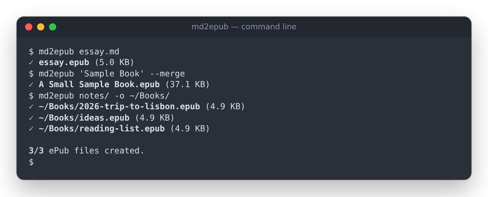

# MD to ePub


**Turn your Markdown notes into clean ePub books for your e-reader.**
One file, a folder of chapters or an Obsidian vault: drag it into the terminal, press Enter a few times, done.



*The book in [`examples/sample-book`](examples/sample-book), straight out of md2epub.*

---

## 1. Install

You only need **Python 3.9+**. Pandoc is bundled, nothing else to install.

```bash
uv tool install git+https://github.com/kxrz/md_to_epub
```

<details>
<summary>Other ways: pipx, no install at all, from a clone</summary>

```bash
# with pipx
pipx install git+https://github.com/kxrz/md_to_epub

# run it once without installing anything (needs uv: https://docs.astral.sh/uv/)
uv run https://raw.githubusercontent.com/kxrz/md_to_epub/main/md_to_epub.py

# from a clone
git clone https://github.com/kxrz/md_to_epub && cd md_to_epub
pip install -r requirements.txt
python md_to_epub.py
```
</details>

## 2. Run `md2epub`

Drag a file or a folder into the terminal and press Enter.



Title, author, language and cover are filled in for you. Press Enter to accept them, and your ePub is ready:



Already in a folder full of notes? md2epub lists them, just pick one:



## 3. Copy it to your reader

| Reader | How |
|---|---|
| Kobo, PocketBook, Boox… | Plug it in via USB and copy the `.epub` file |
| Kindle | Use [Send to Kindle](https://www.amazon.com/sendtokindle), which accepts ePub |
| Apple Books | Open the file, or drag it into the Books app |

---

## Command line

For scripts, or if you know exactly what you want:



```bash
md2epub notes.md                          # -> notes.epub, next to the file
md2epub ch1.md ch2.md ch3.md -t "My Book" # several files -> one book
md2epub my_book/ --merge                  # a folder -> one book
md2epub notes/ -r -o ~/Books/             # a folder (and subfolders) -> one ePub per file
```

<details>
<summary>All options</summary>

| Option | |
|---|---|
| `-o, --output` | Output `.epub` file or folder |
| `-t, --title` | Book title |
| `-a, --author` | Author (remembered for next time) |
| `-l, --lang` | Language code (`en`, `fr`…), auto-detected otherwise |
| `--cover` | Cover image (jpg/png) |
| `-c, --css` | Your own stylesheet |
| `-m, --merge` | Merge everything into one book |
| `-r, --recursive` | Include subfolders |
| `--no-toc` | No table of contents page |
| `--init-css` | Write the default stylesheet to `./epub.css` so you can tweak it |

Options from earlier versions (`--dir`, `--create-css`) still work.
</details>

## What it does for you

- 📝 **Fills in the metadata.** Title from the front matter, the first `# Heading` or the file name
  (`01_my-chapter.md` → *My Chapter*). Your author name is remembered.
- 🖼️ **Finds the cover.** A `cover.jpg` or `cover.png` next to your files becomes the book cover.
- 📖 **Builds real chapters.** Files are sorted in human order (`2` before `10`), each one becomes a chapter.
- 🌍 **Detects the language** so your reader hyphenates words correctly.
- 🔗 **Speaks Obsidian.** `![[image.png]]` is found anywhere in the vault, `[[links]]` become plain text.
- 📐 **Looks like a book.** Justified text, indented paragraphs, no awkward page breaks, long code lines wrapped.
  Your reader's font and size settings keep working.
- ⚠️ **Tells you what's wrong**, like a missing image, instead of failing silently.

<details>
<summary>Metadata: front matter and <code>book.yaml</code></summary>

Put a YAML block at the top of a file:

```markdown
---
title: My Amazing Document
author: Your Name
lang: en
cover-image: images/cover.jpg
description: A comprehensive guide
publisher: Self-Published
date: 2025-01-15
---
```

For a book made of several files, put the same fields in a `book.yaml` (or `metadata.yaml`) inside the folder.
Command-line options always win over what is written in the files.
</details>

<details>
<summary>Organizing a book</summary>

```
my_book/
├── book.yaml          # title, author… (optional)
├── cover.jpg          # used automatically (optional)
├── epub.css           # your own style (optional)
├── 01-introduction.md
├── 02-chapter-one.md
├── 10-conclusion.md
└── images/
```

Try it with the example: `md2epub examples/sample-book --merge`.
</details>

<details>
<summary>Custom style</summary>

The built-in stylesheet is tuned for e-ink. To change it, run `md2epub --init-css`, edit `epub.css`,
and keep it next to your Markdown files (or in the folder you run the command from): it is picked up automatically.
</details>

<details>
<summary>Troubleshooting</summary>

- **"Pandoc was not found"**: run `pip install pypandoc_binary`, or install Pandoc from [pandoc.org](https://pandoc.org/installing.html).
- **An image is missing**: the warning gives its name; check the path is relative to the Markdown file.
- **Wrong order when merging**: prefix files with numbers (`01-`, `02-`…), or choose "let me pick the chapters".
</details>

<details>
<summary>Development</summary>

```bash
pip install -e ".[test]"
pytest
```

Everything lives in a single file, `md_to_epub.py`, so it can also run as a standalone script.
</details>

<details>
<summary>Version history</summary>

**v3.0 (2026)**
- Pandoc bundled, one-line install, `md2epub` command, `uv run` support
- Shorter interactive flow: drag and drop, file picker, remembered author, automatic cover
- Merge several files from the command line, proper chapters, human sort order
- Fixed images not found when converting from another folder or merging
- Front matter is no longer overridden by default values
- Language detection, Obsidian support, better e-reader stylesheet, tests

**v2.0 - Professional Edition (2025)**: interactive TUI, merge mode, CSS management, metadata prompts

**v1.0**: basic CLI conversion with Pandoc
</details>

## License

Free to use and modify for personal and commercial projects.
Credit appreciated but not required: kxrz ([GitHub](https://github.com/kxrz)).

Built with [Pandoc](https://pandoc.org/), [questionary](https://github.com/tmbo/questionary),
[Rich](https://github.com/Textualize/rich) and [pypandoc](https://github.com/JessicaTegner/pypandoc).
