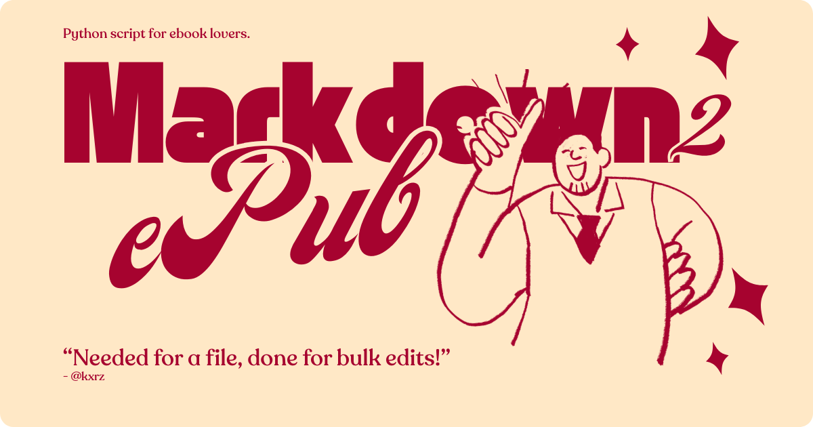

# MD to ePub

**Created by:** kxrz ([GitHub](https://github.com/kxrz))

Turn your Markdown notes into clean ePub books for your e-reader (Kobo, Kindle, PocketBook, Boox, Apple Books…).
One file, a folder of chapters or an Obsidian vault: drag it into the terminal, answer two questions, done.



## Quick start

You only need Python 3.9+. **Pandoc is bundled**, nothing else to install.

```bash
# Run it straight from GitHub, no install (needs uv: https://docs.astral.sh/uv/)
uv run https://raw.githubusercontent.com/kxrz/md_to_epub/main/md_to_epub.py

# Or install the `md2epub` command for good
uv tool install git+https://github.com/kxrz/md_to_epub    # or: pipx install git+https://github.com/kxrz/md_to_epub
md2epub
```

Prefer the classic way? `git clone` this repo, `pip install -r requirements.txt`, then `python md_to_epub.py`.

## Interactive mode

Run `md2epub` with no arguments. If the current folder has Markdown files, pick one from the list;
otherwise **drag a file or folder into the terminal** and press Enter.

```
? Markdown file or folder (you can drag it here): ~/Documents/My Book
? 12 Markdown files found. Create…
  » 📖 One book (12 chapters, in name order)
    📖 One book, let me pick the chapters
    📚 One ePub per file (12 files)
? Title: My Book
? Author: Jane Doe                      ← remembered for next time
Cover: cover.jpg (found automatically)
✓ My Book.epub (1.2 MB)
```

Title, author, language and cover are pre-filled from your files, so most of the time you just press Enter.

## Command line

```bash
md2epub notes.md                          # -> notes.epub, next to the file
md2epub notes.md -o ~/Books/              # choose where it goes
md2epub ch1.md ch2.md ch3.md -t "My Book" # several files -> one book
md2epub my_book/ --merge                  # a folder -> one book
md2epub notes/ -r -o epubs/               # a folder (and subfolders) -> one ePub per file
```

| Option | |
|---|---|
| `-o, --output` | Output `.epub` file or folder |
| `-t, --title` | Book title |
| `-a, --author` | Author (remembered for next time) |
| `-l, --lang` | Language code (`en`, `fr`…), auto-detected otherwise |
| `--cover` | Cover image (jpg/png) |
| `-c, --css` | Your own stylesheet |
| `-m, --merge` | Merge everything into one book |
| `-r, --recursive` | Include subfolders |
| `--no-toc` | No table of contents page |
| `--init-css` | Write the default stylesheet to `./epub.css` so you can tweak it |

Options from earlier versions (`--dir`, `--create-css`) still work.

## What it does for you

- **Smart metadata.** Title comes from the front matter, else the first `# Heading`, else the file name
  (`01_my-chapter.md` → *My Chapter*). The author you typed last time is remembered.
- **Language detection** (English, French, German, Spanish, Italian, Portuguese, Dutch), so your e-reader
  hyphenates with the right rules.
- **Automatic cover.** A `cover.jpg` or `cover.png` next to your files is used as the book cover.
- **Real chapters when merging.** Files are sorted in human order (`2` before `10`). A file without a `#` heading
  still becomes a chapter, titled after its front matter or file name.
- **Images just work**, wherever your notes live, including when merging files from several folders.
- **Obsidian friendly.** `![[image.png]]` embeds are found anywhere in the vault, `[[wikilinks]]` become plain text,
  `==highlights==` are kept.
- **E-reader stylesheet.** Book-like typography that leaves font and size settings to your reader, wraps long
  code lines and avoids awkward page breaks.
- **Clear warnings** when an image is missing, instead of a silent failure.

## Metadata

Put a YAML block at the top of a file:

```markdown
---
title: My Amazing Document
author: Your Name
lang: en
cover-image: images/cover.jpg
description: A comprehensive guide
publisher: Self-Published
date: 2025-01-15
---
```

For a book made of several files, put the same fields in a `book.yaml` (or `metadata.yaml`) inside the folder.
Command-line options always win over what is written in the files.

### Organizing a book

```
my_book/
├── book.yaml          # title, author… (optional)
├── cover.jpg          # used automatically (optional)
├── epub.css           # your own style (optional)
├── 01-introduction.md
├── 02-chapter-one.md
├── 10-conclusion.md
└── images/
```

Try it with the example: `md2epub examples/sample-book --merge`.

## Styling

The built-in stylesheet is tuned for e-ink. To customize it, run `md2epub --init-css`, edit `epub.css`,
and keep it next to your Markdown files (or in the folder you run the command from): it is picked up automatically.

## Sending the book to your reader

- **Kobo / PocketBook / Boox:** plug it in via USB and copy the `.epub` file.
- **Kindle:** use [Send to Kindle](https://www.amazon.com/sendtokindle), which accepts ePub directly.
- **Apple Books:** open the file, or drag it into the Books app.

## Troubleshooting

- **"Pandoc was not found"**: run `pip install pypandoc_binary`, or install Pandoc from [pandoc.org](https://pandoc.org/installing.html).
- **An image is missing**: the warning gives its name; check the path is relative to the Markdown file.
- **Wrong order when merging**: prefix files with numbers (`01-`, `02-`…), or choose "let me pick the chapters".

## Development

```bash
pip install -e ".[test]"
pytest
```

Everything lives in a single file, `md_to_epub.py`, so it can also run as a standalone script.

## Version history

### v3.0 (2026)
- Pandoc bundled, one-line install, `md2epub` command, `uv run` support
- Shorter interactive flow: drag and drop, file picker, remembered author, automatic cover
- Merge several files from the command line, proper chapters, human sort order
- Fixed images not found when converting from another folder or merging
- Front matter is no longer overridden by default values
- Language detection, Obsidian support, better e-reader stylesheet, tests

### v2.0 - Professional Edition (2025)
- Interactive TUI, merge mode, CSS management, metadata prompts

### v1.0 - Initial Release
- Basic CLI conversion with Pandoc

## License

Free to use and modify for personal and commercial projects.
Credit appreciated but not required: kxrz ([GitHub](https://github.com/kxrz))

**Built with** [Pandoc](https://pandoc.org/), [questionary](https://github.com/tmbo/questionary),
[Rich](https://github.com/Textualize/rich) and [pypandoc](https://github.com/JessicaTegner/pypandoc).
